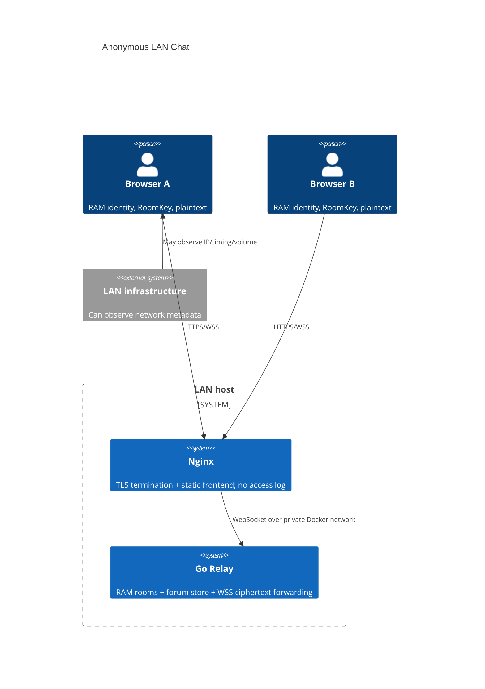
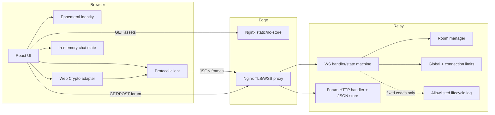
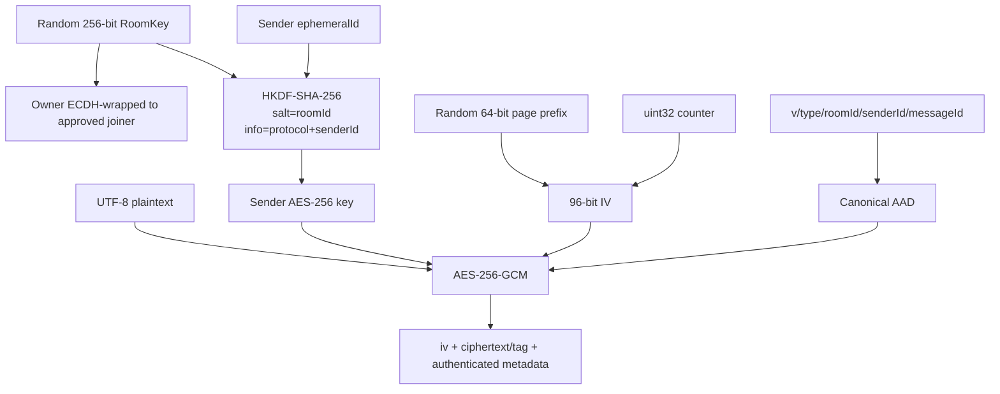
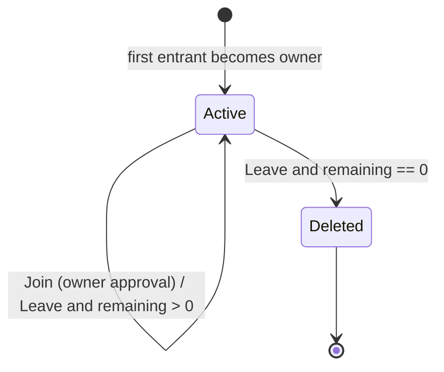
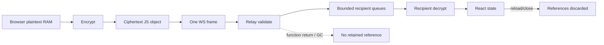
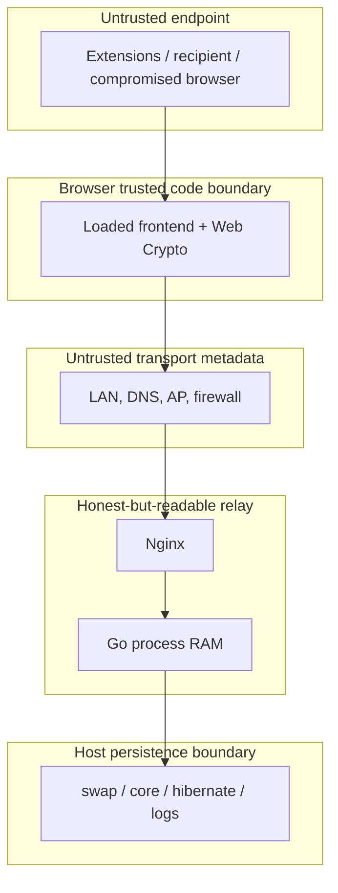
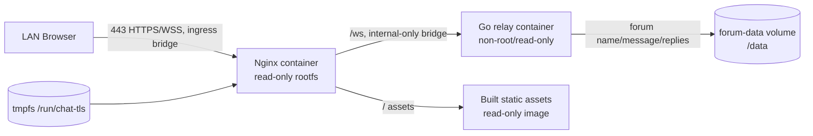

# Architecture

## 1. Decision Summary

Frontend 采用 React + TypeScript + Vite；Relay 采用 Go + `github.com/coder/websocket`。Node/TypeScript 后端可共享类型且早期代码量略少，但 Go 的单 binary、清晰并发/内存所有权、标准库 HTTP、较小运行镜像和低依赖更适合长期运行的窄职责 relay。`coder/websocket` 是无传递依赖、通过 Autobahn 测试的维护中库；相比 Socket.IO，它不引入自有事件/重连语义或额外客户端状态。

| 维度 | Node.js + ws | Go + coder/websocket | 选择依据 |
|---|---|---|---|
| 初始代码量 | 较少 | 略多 | 不是唯一目标 |
| 并发/背压 | event loop，需谨慎限制 buffer | goroutine + bounded channel 明确 | Go |
| 类型/审计 | TS 良好，运行时仍需 schema | 结构体 + 严格 decoder | Go |
| 部署 | Node runtime + dependencies | 单 binary | Go |
| 镜像/内存 | 通常较大 | 通常较小 | Go |
| 前后端类型共享 | 容易 | 手工对齐 | Node 优势，但协议很小 |
| 维护 | npm + runtime updates | Go module + binary | Go |

## 2. System Context



## 3. Component Diagram



## 4. Repository Layout

```text
web/                    React/Vite client
  src/crypto/           Room key, KDF, HMAC, AES-GCM, envelope/AAD
  src/protocol.ts       Browser protocol types/guards
  src/App.tsx           Runtime-only identity/chat state and UI
server/                 Go module
  cmd/chatroom/         Process lifecycle and HTTP server
  internal/room/        Concurrent RAM room manager
  internal/protocol/    Strict envelopes and validation
  internal/relay/       WS connection state machine/limits
  internal/forum/       Public forum store/API; only name/message/replies
deploy/nginx/           TLS/static/proxy config and startup
docs/                   Product, architecture, security, audit
```

## 5. Data Flow

```mermaid
sequenceDiagram
  participant A as First Entrant (owner)
  participant R as Blind Relay
  participant B as Later Joiner
  A->>A: Pick room 0001-0008; generate identity + admission keypair
  A->>R: join_room(roomId, identity, admission public key)
  R->>R: Room empty -> create; A becomes owner (RoomKey stays in A)
  R-->>A: joined + presence
  B->>B: Pick the same room; generate identity + admission keypair
  B->>R: join_room(roomId, identity, admission public key)
  R-->>B: join_pending
  R->>A: join_request(joiner nickname)
  A->>A: Wrap RoomKey to joiner ECDH key
  A->>R: admission_decision(approved, wrapped RoomKey)
  R-->>B: join_approved(wrapped RoomKey)
  B->>B: Unwrap RoomKey
  B->>R: admission_complete
  R-->>B: joined + current presence
  A->>A: HKDF sender key; AES-GCM plaintext or image
  A->>R: ciphertext envelope
  R->>B: same ciphertext envelope
  B->>B: HKDF sender key; AES-GCM decrypt
```

RoomKey 不出 Browser 边界，服务器从不接收它：房主用 ECDH 派生的临时密钥把 RoomKey 封装后经 Relay 转交，Relay 只转发封装密文。没有密码或口令派生——授权完全由房主逐人批准。Relay 看见实时 roomId、ephemeral identity、presence 和 ciphertext 大小/时序，这是完成路由所必需的最小应用元数据。

## 6. Encryption Flow



## 7. Room State and Synchronization

`Manager` owns `map[string]*Room`、room/member capacity 与一把互斥锁。每个 `Room` 只有 owner 指针、`members`/`pending`/`approved` 三张 map；它从不拥有 message slice。统一的 manager lock 让 enter/join/leave/delete 决策保持原子且降低锁顺序复杂度。成员有固定容量 outbound channel；broadcast 在锁内复制 recipients 后解锁并 non-blocking enqueue。队列满会取消慢连接，而不是保留更多数据或阻塞房间。

`Manager.Leave` 在同一 manager lock 内查找 Room、删除 member，并在成员数为零时删除 map entry；`Enter` 与 leave 使用同一把锁，因此「某成员成为空房首位进入者」与「房间被删除」不会交错。

Room 额外记录 `OwnerConnectionID`，首位进入者是初始房主。房主离开而仍有成员时，`Leave` 在同一把锁内从剩余成员中随机选出新房主，并把这些待审批申请标记为 `OWNER_CHANGED` 拒绝；新房主随后收到带新 `ownerEphemeralId` 的 presence 广播。



## 8. Connection State Machine

```mermaid
stateDiagram-v2
  [*] --> AwaitingAction: WS accepted
  AwaitingAction --> Joined: join empty room (becomes owner)
  AwaitingAction --> AwaitingApproval: join occupied room
  AwaitingApproval --> Joined: owner approved + admission_complete
  AwaitingApproval --> Closing: owner rejected / owner changed
  AwaitingAction --> Closing: timeout/protocol error
  AwaitingApproval --> Closing: timeout
  Joined --> Closing: peer close/server shutdown/policy
  Closing --> [*]: member removed; maybe room deleted
```



每条连接只有一个 reader 和一个 writer goroutine。所有网络写进入固定容量 channel；context cancellation 结束二者，成员清理由单一 `serveConnection` defer 路径执行一次。

## 9. Message Lifecycle



临时聊天室不提供 ACK 重试、消息队列、历史 endpoint 或 replay store。服务器只在当前 read buffer 和接收者 bounded send channel 中瞬态持有 ciphertext。公共吐槽板使用独立的 JSON API 和持久文件，论坛线程及回复只保存名字与内容。

## 10. Protocol Validation

- JSON text frames only；compression disabled。
- `SetReadLimit(2 MiB)`；客户端正文解密前服务端只能限制 ciphertext/base64 长度。
- 顶层 envelope 先解析 `type`，再用 `DisallowUnknownFields` 解码具体结构，并要求 EOF。
- roomId：固定 8 个房间之一（`0001`–`0008`）；UUID：标准 canonical 字符；nickname：trim 后 2–24 个 Unicode code points，拒绝 control/format/line-separator 字符。
- base64url 无 padding；IV 解码必须 12 bytes；ECDH 公钥必须 65 bytes 且首字节 0x04，封装字段定长（IV 12、wrapped key 48）。
- ciphertext 最小 16-byte tag，最大对应 1 MiB plaintext（文本或图片）。

## 11. Threat Boundaries



E2EE protects content across T3/T4 only while浏览器加载的是可信前端。控制 T4 并主动修改静态 JS 的攻击者跨越了信任根；部署应使用只读镜像、镜像 digest、变更审批与可复现 build 来降低风险，但 MVP 不能消除它。

## 12. Browser Storage Policy

- 所有敏感 state 只使用组件 state、module object、closure 和 non-extractable derived CryptoKey。
- RoomKey 只在创建者浏览器内存与 CryptoKey 引用中存在；需要交给经批准的新成员时，用 ECDH 派生的临时密钥封装后经 Relay 转发，不写 Storage，也不进入 URL。
- 不产生携带 secret 的 URL fragment；React 路由不把 secret 放 state history。
- `Cache-Control: no-store` 作用于 HTML/JS/CSS；无 manifest、SW 或离线 fallback。
- 显式 Leave/reset 时关闭 socket 并清空 room/message/key refs；页面卸载关闭 socket，随后整个 realm/state 被浏览器丢弃。GC 清理不可精确保证，文案不宣称 secure erase。

## 13. Server RAM Policy

允许：活动 roomId、成员 connectionId/ephemeralId/nickname/socket queue、待审批申请、连接限流 bucket、瞬态 ciphertext frame（文本或图片）。改名在 manager lock 内替换当前 Member nickname 并广播 presence，不生成历史。论坛请求体在 Store 写入前只保留 `name`、`message` 和回复列表中的这两个字段。  
禁止：RoomKey、plaintext password/message、聊天室 `messages/history`、IP/header/UA、account/device/fingerprint、tombstone、analytics、除论坛 Store 外的跨重启 state。

## 14. Zero-Persistence Logging Policy

生产应用只允许固定文本：`server_started`、`server_stopped`、`fatal:<allowlisted-code>`。不把 Go `error` 直接格式化，因为底层错误可能带 address/URL。普通连接、认证失败、限流、room lifecycle、论坛读写不写日志。Debug build/runtime 默认关闭，且 debug helper 仍不得打印 payload/key/password/IP。

Nginx access/error log 均指向关闭/丢弃；Docker driver 为 `none`。因此 `docker logs` 不可用于运维排障，这是明确的隐私换可观测性取舍。

## 15. Deployment Architecture



生产证书通过只读 bind mount 提供；若缺失，entrypoint 在 tmpfs 生成默认含 `chat.local`、`localhost` 和 loopback SAN 的临时自签证书（可用 `CERT_HOSTS` 调整）。只有 edge 接入可发布端口的 ingress bridge；Relay 只接入 internal-only bridge。两个容器均 drop capabilities、`no-new-privileges`、read-only filesystem、tmpfs runtime；Relay 仅额外挂载 `/data` forum-data volume，聊天状态仍不落盘。

## 16. Public Forum Persistence

论坛通过 `/api/board/posts` 提供 GET/POST，通过 `/api/board/posts/{index}/replies` 为每条主留言添加回复。索引只作为当前数组位置用于路由，不写入数据文件，也不作为用户标识。JSON 中每个线程只有 `name`、`message`、`replies`；每个回复只有 `name`、`message`。没有时间、IP、MAC、User-Agent、连接 ID、随机帖子 ID 或访问日志字段。

Store 使用进程内互斥锁、严格 JSON decoder、固定大小上限和 0600 原子替换写入。容器 root filesystem 保持只读，只有命名 volume `/data` 可写。文件系统可能自行维护 mtime/ctime 等宿主级属性，应用不读取、保存为字段或展示这些属性；因此产品层承诺是“不保存发表时间字段和请求元数据”。

## 17. Failure Semantics

- Relay 重启：所有连接/房间丢失，这是 feature。
- Nginx 重启：socket 断开；若造成最后成员离开，房间删除。
- 客户端掉线：不补发；UI 返回首页并清除 state。
- 广播时慢接收者：断开慢客户端；不阻塞、不扩容 queue。
- browser crypto 不支持或非 secure context：fail closed，不发送明文。
