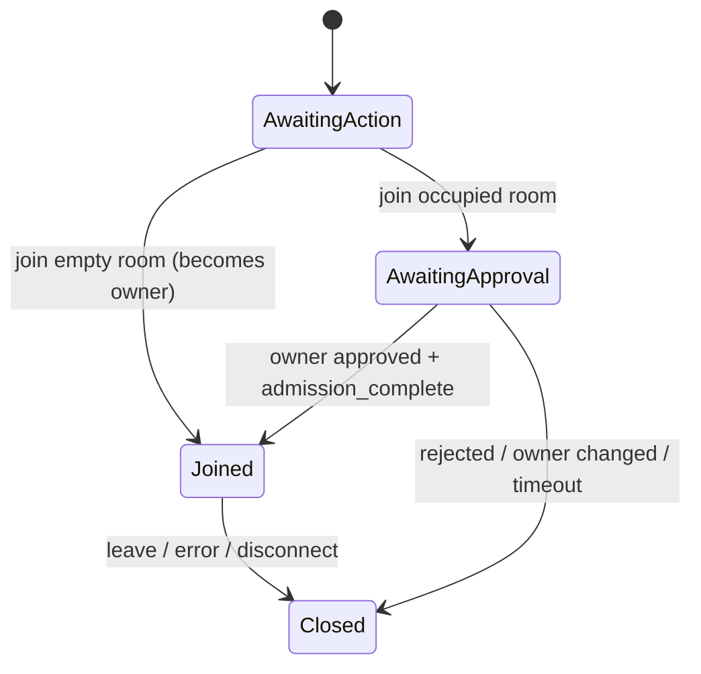

# 局域网匿名临时聊天室 PRD

状态：MVP 基线 1.1  
产品原则优先级：Security > Features；Simplicity > Cleverness；临时聊天 Memory-only，公共板显式 Persistence

## 1. Product Vision

提供一个由组织自行部署的浏览器聊天室和公共吐槽板：聊天室无需安装、注册或长期身份，消息在浏览器加密，服务器只维护当前连接和活动房间并转发密文；吐槽板允许所有人使用虚拟名字发帖和回复，并持久保存内容。产品准确承诺 **No application-level IP logging、No IP retention、No persistent identity；临时聊天室 No message persistence**，不宣称绝对匿名或不可追踪。

核心生命周期：打开浏览器 → 新临时身份 → 创建/加入临时房间 → 浏览器端加密 → 实时转发 → 断线不补发 → 最后一人离开 → 房间立即消失。

## 2. Goals

- 无账户、Cookie、长期 token、设备标识或用户数据库。
- 文本消息端到端加密；Relay 无 RoomKey，不能正常解密消息。
- 临时聊天室浏览器和服务器均不持久化聊天消息；后加入者不从系统获得旧消息。公共吐槽板是明确例外，只持久化虚拟名字、留言和回复内容。
- 房间、成员、待审批申请、限流状态全部只在 RAM；公共板数据单独持久化。
- 空房间同步删除；服务重启后临时房间状态消失，公共板线程和回复可恢复。
- HTTPS/WSS 默认部署，并关闭应用、Nginx、Docker 的访问数据落盘；论坛内容只写入单独的受限数据 volume。
- 小型、类型明确、有自动化测试、可逐文件审计。

## 3. Non-Goals

MVP 不实现账户、登录、永久昵称、好友、私聊、永久房主权限、历史/离线消息、搜索/编辑、除图片外的文件、音视频、机器人、AI、目录/匹配、审核后台、封禁、IP 黑名单、统计、遥测、Sentry、PWA、Service Worker、通知和恢复会话。

“阅后销毁”不属于承诺：接收者能截图、拍照、复制或修改浏览器。系统也不隐藏网络连接对路由器、AP、防火墙、DHCP、IDS/IPS、宿主 OS 和实时 TCP 表的可见性。

## 4. Core Principles

1. Zero Account：每次页面装载生成全新身份，刷新即销毁。
2. Scoped Persistence：临时聊天室应用数据不写浏览器持久存储、数据库、文件或持久队列；公共板只写受限 JSON volume。
3. Blind Relay：服务端不接收 RoomKey 或明文消息。
4. Empty Means Destroyed：成员数降为零时立即删除房间，无宽限、tombstone 或 reconnect 保留。
5. Metadata Minimization：协议不含消息时间戳；昵称、roomId、messageId 仅在实时处理所需范围内存在。
6. Honest Claims：区分应用层不保留 IP 与网络层无法隐藏 IP；区分 E2EE 与 Forward Secrecy。
7. Forum Data Boundary：公共板的持久记录只包含虚拟名字、留言和回复内容，不含 IP、MAC、发表时间、User-Agent、连接 ID 或随机帖子 ID。

## 5. User Personas

- 局域网普通成员：希望无需账户快速发起一次性对话。
- 房主：进入空房间的第一人，负责审批之后每一位加入者；房主身份只在当前房间有效，离开后自动转移给剩余成员。
- 自托管运维人员：需要可重复部署、最小日志、明确主机加固边界。
- 安全审计人员：需要小协议、数据清单、测试和自动化禁用项扫描。

## 6. User Stories

- 作为访客，我打开页面便从 3,544 项金庸小说、金瓶梅与四大名著人物表获得随机显示名，可在当前会话手动修改，刷新后身份重新生成。
- 作为访客，我在首页从 0001–0008 中选一个房间进入；若房间为空，我直接成为房主。
- 作为房主，我审批每一位加入者，RoomKey 只在他被批准时经 ECDH 交付，Relay 永远拿不到明文 RoomKey。
- 作为加入者，我等待房主批准后加入并解密新消息；此外我可以发送图片。
- 作为成员，我只能看到自己在线期间实时收到的消息。
- 作为运维人员，我重启服务后确认所有房间消失，磁盘上没有聊天状态。
- 作为访客，我可以在公共吐槽板用虚拟名字发布留言、查看已保存内容，并对每条主留言回复；服务重启后这些论坛内容仍可恢复。

## 7. Functional Requirements

### 7.1 首页与身份

- 页面装载时用 `crypto.randomUUID()` 生成 `ephemeralId`，并用无偏 CSPRNG 索引从本地 3,544 项金庸小说、金瓶梅与四大名著人物名表选择显示名。
- 两者仅存在 React state/ref 与 WebSocket 生命周期；不允许存入 URL、Cookie 或任何 Storage API。
- 显示名允许修改为 2–24 个可见 Unicode code points；拒绝 control/format/line-separator 字符。改名只更新当前浏览器 state 和当前 Room member，不改变 `ephemeralId`，断线后消失。
- 首页列出固定的 8 个房间（0001–0008）。点选即请求进入；没有创建流程、没有密码、没有邀请链接，RoomKey 由房主在批准后用 ECDH 封装发给新成员。

### 7.2 固定房间

- 全文只有 8 个固定房间，房间号为 `0001`–`0008`，不需要也不能手动创建。
- 房间只在有人时存在于 Relay RAM：进入空房间的第一人成为房主并直接进入；最后一人离开即销毁，房间号回到空置。
- 没有密码。每个房间的 RoomKey 由该房间的房主在浏览器内生成（首位进入者），并在批准新成员时经 ECDH 封装转交。

### 7.3 入房审批

- 房间已有人时，加入者发出 `join_room`，服务端把它作为待审批申请转给当前房主；加入者收到 `join_pending`。
- 房主在页面上同意或拒绝；被拒绝者收到 `JOIN_REJECTED`。
- 房主同意时用基于 ECDH 的一次性临时密钥把 RoomKey 封装后经 Relay 转交，Relay 只见封装密文。
- 房主离开会使待审批申请失效（`OWNER_CHANGED`），加入者需重新申请。
- 待审批申请最多等待房主 60 秒决定；超时连接断开、申请作废，加入者需重新申请。该窗口独立于 15 秒握手 deadline，因为同意与否由人在页面上决定。

### 7.4 加入与聊天

- 空房间直接进入；非空房间需当前房主批准，二者都不需要密码。
- Presence 只包含当前成员临时昵称与 ephemeralId；Relay 可见该实时元数据。
- 文本消息与图片消息都端到端加密。图片在发送前由浏览器压缩到约 500KB 以内；加密后的单帧上限 2 MiB。
- Relay 不回显历史。发送者本地显示自己的消息；服务端仅向其他成员转发，避免重复。

### 7.5 公共吐槽板

- 公共板独立于临时聊天室，页面加载后通过 HTTPS API 获取已保存的论坛线程。
- 发布留言和回复都只提交 `name`、`message` 两个字段；虚拟名字 2–24 个可见 Unicode 字符，内容最多 2,000 个 Unicode 字符。
- 每条主留言都有回复入口。回复保存在该线程的 `replies` 列表中，回复元素同样只有 `name`、`message`。
- 服务端使用单独的 JSON 文件和命名 volume 持久化；文件、API 响应和 UI 不生成/展示时间、IP、MAC、User-Agent、请求头、连接 ID 或随机帖子 ID。
- 论坛没有账户、编辑、删除、搜索或管理后台；帖子容量达到上限后拒绝新留言，不通过收集 IP 实现反滥用。

## 8. Non-Functional Requirements

- 支持最新两个主要版本 Chrome、Edge、Firefox、Safari；必须是 secure context。布局适配 280px 以上手机 viewport、动态 viewport height 和至少 44px 触控按钮。
- 默认上限：8 个固定房间、2,000 连接、50 人/房间。
- 每连接消息 token bucket：突发 12，补充 5/秒；协议错误和超限可关闭连接。
- 单个慢客户端的发送队列满时断开该客户端，不缓存无限消息。
- Go 进程优雅关闭；临时聊天室状态仅随进程存在，论坛内容由独立 Store 持久化。
- 前端 lint、TypeScript strict、单元测试、production build；后端 `go test`、`go vet`。

## 9. Privacy Requirements

- 禁止使用 `localStorage`、`sessionStorage`、IndexedDB、Cookie、Cache API、WebSQL、OPFS、Service Worker 和客户端 analytics。
- 应用代码禁止读取 `RemoteAddr`、`req.ip`、转发 IP headers 或 User-Agent。
- 禁止建立 ephemeralId/roomId/messageId 到 IP 的映射。
- 公共吐槽板持久记录仅允许虚拟名字、留言和回复内容；禁止 IP、MAC、发表时间、User-Agent、请求头、连接 ID、随机帖子 ID 等字段。
- Nginx `access_log off`；错误日志丢弃。Compose 使用 Docker `logging.driver: none`。
- HTTP 响应使用 `Cache-Control: no-store`；不注册 Service Worker。静态资源仍可能由浏览器实现持有于普通 HTTP 内存/磁盘缓存，因此 `no-store` 是要求而非对浏览器内部实现的绝对物理保证。

## 10. Security Requirements

- WSS/HTTPS；严格 Origin allowlist（配置的 origins 或同 Host），不使用 wildcard。
- AES-256-GCM，128-bit tag，96-bit IV，envelope metadata 作为 AAD。
- 每发送者用 HKDF-SHA-256 从 RoomKey 和 `ephemeralId` 派生子密钥，隔离 nonce 命名空间。
- 每页面生命周期生成随机 64-bit nonce prefix，加 32-bit 单调计数器形成 96-bit IV；计数器耗尽前拒绝发送。
- 接收端以 `senderEphemeralId + messageId` 的有界集合拒绝当前会话内重放。
- 严格 JSON schema、精确字段、base64url/长度检查、frame 限制、origin 验证、心跳、握手超时。
- HTML 仅通过 React 文本节点渲染，不使用 `dangerouslySetInnerHTML`。
- CSP、`Referrer-Policy: no-referrer`、`X-Content-Type-Options: nosniff`、frame 禁止策略。

## 11. Room Lifecycle

```mermaid
stateDiagram-v2
  [*] --> Active: first entrant becomes owner
  Active --> Active: member joins (with owner approval) / leaves; count > 0
  Active --> Destroyed: last member disconnects
  Destroyed --> [*]
```



不存在 Empty、GracePeriod、Recoverable 或 Ownerless 特殊状态：只要房间存在就必有房主。首位进入者是初始房主；房主离开时立即在剩余成员中随机转移，并拒绝当时的待审批申请。刷新导致旧 socket 离开；若其为唯一成员，旧房间立即被删除，新页面进入会重新成为房主。

## 12. Identity Lifecycle

`page load → CSPRNG ephemeralId/nickname → connection-scoped server member → disconnect/page close → references removed`。刷新不是恢复。服务器可分配内部 `connectionId`，仅用于当前 socket，不返回作长期身份。

## 13. Admission Authorization

### 13.1 MVP 协议

房间没有密码，也没有口令派生。授权完全由当前房主逐人批准：

1. 客户端发送 roomId、临时身份和一次性入房公钥。
2. 房间为空：服务端原子创建 Room，把该连接设为房主并直接加入（`joined`）。
3. 房间非空：服务端登记待审批申请，向加入者回 `join_pending`，并向房主转发 `join_request`。
4. 房主同意时，用加入者本次连接提交的一次性 ECDH 公钥（P-256）派生封装密钥，把 RoomKey 以 AES-256-GCM 封装（AAD 绑定 `roomId + requestId`）后转交；加入者用本地私钥解出。
5. 加入者解出 RoomKey 后发送 `admission_complete`，成为正式成员；房主也可以拒绝（`JOIN_REJECTED`）。

### 13.2 明确限制

- 没有口令意味着没有第二道门槛：安全性取决于房主不误批，以及房主本人在线且可信。任何未获批准的连接都拿不到 RoomKey，也就无法解密消息。
- 房主离开会使待审批申请作废，由剩余成员随机产生新房主。
- RoomKey 是独立 CSPRNG 256-bit secret，只在房主批准入房时经 ECDH 封装转交，不进入 URL，也不被服务器解出。
- 未来如需口令/PAKE（OPAQUE、SPAKE2）或 Argon2id，应作为独立设计引入，不与当前流程混用。

## 14. Encryption Design

- RoomKey：创建浏览器随机生成；仅在房主批准入房时以 ECDH 封装形式经服务器转发，服务器不接收明文 RoomKey。
- SenderKey：`HKDF-SHA-256(RoomKey, salt=roomId UTF-8, info="lan-chat-message-v1" || ephemeralId)`。
- IV：发送者随机 8 bytes prefix + big-endian uint32 counter；在当前 sender key 下不复用。
- plaintext：UTF-8 文本；GCM 输出包含 16-byte tag。
- AAD：固定字段顺序编码 `v\ntype\nroomId\nsenderEphemeralId\nmessageId`，防止 Relay 修改路由元数据而仍可解密。
- 解密失败只在 UI 显示泛化错误，不打印 envelope、key 或异常对象。
- JS 无法保证可靠地清零 GC 管理的字符串/CryptoKey；离开时删除引用是 best effort，不宣称物理内存擦除。

固定 RoomKey 的安全边界：任一当前成员拥有群组根密钥，能解密其保存到的全部同一 RoomKey 密文、伪造群组成员消息，并在密钥泄露后回溯解密攻击者保存的密文；MVP 没有 Forward Secrecy、成员移除后的密钥轮换或强发送者认证。

## 15. Message Protocol

密文 envelope（无 timestamp）：

```json
{
  "v": 1,
  "type": "ciphertext",
  "roomId": "7FH2MXP9ABCD",
  "senderEphemeralId": "uuid",
  "messageId": "uuid",
  "iv": "base64url-12-bytes",
  "ciphertext": "base64url-ciphertext-and-tag"
}
```

时间戳不是路由、解密或重放防护所需；去掉它减少元数据和时钟信任。UI 按到达顺序显示。`messageId` 为随机 UUID，只做会话内去重；服务端不留全局消息 ID 集合。

## 16. WebSocket Protocol

Client → Server：`join_room`、`rename`、`admission_decision`、`admission_complete`、`ciphertext`。  
Server → Client：`joined`、`join_pending`、`join_request`、`join_approved`、`presence`、`ciphertext`、`error`。

每个连接状态：



一个连接最多加入一个房间。Relay 只接受已加入连接发出的 ciphertext，并验证 envelope 的 roomId 与 senderEphemeralId 与当前成员一致。

## 17. Error Handling

- 对客户端仅返回固定 error code：`INVALID_MESSAGE`、`ROOM_NOT_FOUND`、`ROOM_FULL`、`RATE_LIMITED`、`CAPACITY_REACHED`、`JOIN_REJECTED`、`OWNER_CHANGED`；错误 Origin 在握手阶段直接返回 HTTP 403。
- 生产日志使用固定 allowlist 事件；绝不 dump request、socket、headers、payload、roomId、nickname 或 error object。
- recoverable 客户端错误不产生服务端日志；fatal 仅记录固定类型码。

## 18. Abuse Protection

- 全局原子连接/房间上限；每房间成员上限；frame 和文本大小限制。
- 每连接 token bucket 与握手 deadline；待审批等待另设 60 秒 deadline；发送队列固定容量；ping/pong 清除死连接。
- 待审批申请与连接生命周期绑定，断连即作废；反复重连的骚扰由房主拒绝处理。
- 不为更强限流建立 IP/设备持久映射。严格长期 anti-abuse 与无长期身份/IP 天然冲突；连接洪泛需要防火墙/反向代理/网络设备协助，其元数据政策由组织负责。

## 19. Threat Model

| 攻击者/事件 | MVP 提供的保护 | 不提供的保护 |
|---|---|---|
| A. Relay 运行内存被动读取 | 无 RoomKey/消息明文；仅见密文、活动房间、成员和连接元数据 | root 可读网络实时 IP；若主动替换前端 JS，可窃取未来明文/密钥 |
| B. Server disk 被复制 | 无房间/消息数据库或应用访问日志 | 镜像含公开前端；宿主 swap/core dump 需运维加固 |
| C. Docker volume 被复制 | Compose 不为应用状态配置 volume | 外部挂载的 TLS key 与主机日志不属于聊天历史 |
| D. 后加入者 | 服务端不缓存/补发旧消息 | 若其从其他成员或抓包者取得旧密文，固定 RoomKey 不具 backward secrecy |
| E. LAN 抓包 | TLS/WSS + E2EE；正常仅见加密流和流量形态 | IP、端口、时序、长度等网络元数据仍可见 |
| F. 未获批准的连接 | 拿不到 RoomKey，无法解密消息 | 房主误批即可加入；没有口令作为第二道门槛 |
| G. 浏览器端被控 | 无法保护 | 恶意扩展、XSS、键盘记录、屏幕读取可见明文/密钥 |
| H. 接收者保存 | 无法保护 | 截图、拍照、复制、开发者工具和改版客户端 |
| I. 网络管理员 | 应用不采集或持久映射 IP | 网络设备和 OS 可独立保留 metadata |
| 恶意房间成员 | GCM 检测链路篡改 | 共享 RoomKey 使成员可构造任意 sender AAD；V1 无强发送者认证 |

## 20. Data Lifecycle

详表见 [`PRIVACY_ARCHITECTURE.md`](../PRIVACY_ARCHITECTURE.md)。概括：临时聊天室 plaintext、图片、RoomKey 和消息列表只在浏览器 RAM；服务器持有活动 Room、成员、待审批申请和瞬态 ciphertext。公共吐槽板仅将 name/message/replies 写入 `/data`，不写时间、IP、MAC 或请求元数据。网络栈、GC 副本、swap、hibernation、core dump 是需明确管理但不能由 Web 应用绝对控制的边界。

## 21. Deployment Model

浏览器 → HTTPS/WSS Nginx → Go Relay。Nginx 提供前端静态文件并代理 `/ws` 和论坛 API；Go 仅监听 Docker 内网。默认 compose 启动时在 tmpfs 生成自签证书，便于立即验证但浏览器不信任；生产应挂载公司 CA 签发证书。论坛 JSON 只写入 `/data` volume。

- 公司 CA：LAN 设备信任体验最好，运维成本中等，推荐生产。
- 内部 ACME：自动续期最佳，但需内部 PKI。
- mkcert：适合小规模测试，每台设备需安装本地 CA，不适合作为组织生产 CA。
- 自签：启动简单但有警告，用户养成忽略证书警告的风险，仅开发/验收。

## 22. Browser Compatibility

依赖 Web Crypto 的 AES-GCM、HKDF、ECDH、`crypto.randomUUID/getRandomValues`、`createImageBitmap` + canvas（图片压缩）、WebSocket 和 Clipboard（复制房间号失败时可手选）。Web Crypto 加解密要求 secure context，因此 HTTPS 是功能要求。旧浏览器直接显示不支持，不降级到自制 crypto 或明文。

## 23. Security Limitations

- 未经独立安全审计，不适用于生命安全、高危举报或对抗国家级攻击者。
- 固定群组 RoomKey，无 FS、post-compromise security、成员撤销轮换；也没有口令/PAKE 门槛。
- 同源服务器能主动投毒它所服务的 JavaScript；浏览器-only 应用无法仅靠自身解决该信任根问题。
- 流量分析、实时 IP、DNS、证书访问、端点缓存实现、内存取证和接收者保存不在绝对保护范围。
- “RAM-only”只描述临时聊天室，不等于主机物理层保证从未落盘；论坛 JSON 是明确的持久化例外。

## 24. Acceptance Criteria

- Compose 一条命令启动 HTTPS/WSS；A 进入空房间成为房主，B 申请、经 A 批准后加入并聊天。
- Relay 测试观察到 ciphertext 而不能从其状态取得 RoomKey/明文。
- B 加入前 A 的消息不被 B 收到；断线期间消息丢弃。
- 最后一人断开后 `rooms.Has(id) == false`；再次进入同一房间号会新建为空房间。
- 服务重启后临时房间消失；聊天室不存在 history API、数据库或持久 queue。论坛使用单独的受限 volume 保存其明确允许的内容字段。
- 房主同意/拒绝行为正确；未获批者拿不到 RoomKey。
- 图片消息能被压缩、加密、转发并解密，且超限图片被拒绝。
- 公共板留言和回复只保存 name/message 内容，重启后可恢复，响应不含时间、IP、MAC、User-Agent 或随机 ID。
- IV 唯一性测试、oversize、origin、rate limit、capacity、malformed protocol 测试通过。
- 禁用持久浏览器 API 与敏感日志关键字审计完成。

## 25. MVP Scope

仅包含临时身份、8 个固定房间（无密码、空房首位进入者即房主、之后需房主审批）、房主离开随机转移、文本与图片 E2EE、在线人数/成员、即时销房、限流/容量/输入加固、HTTPS/WSS Docker 部署及文档测试。无永久房主、设置修改和 reconnect。

## 26. Future Roadmap

- V2：可选口令/PAKE（OPAQUE/SPAKE2）与 Argon2id；为房间增加口令门槛，但不替代房主审批。
- V2：ephemeral X25519 握手 + 身份确认 UX；降低直接共享群组根密钥的范围，但需解决多人加入认证。
- V3：每成员/每消息 ratchet 与 rekey，获得有限 Forward Secrecy 和离开成员撤销。
- V4：Group Sender Keys / group ratchet，兼顾群聊效率、成员变更与发送者认证。
- 之后才评估每消息显示期限、手动销房、WebRTC direct、RAM-only 文件、WebRTC 音频；任何扩展须重新通过零持久化审计。

## 27. 参考实现结论

- [`aditya8Raj/anon-chat`](https://github.com/aditya8Raj/anon-chat)：实际 `server.js` 使用 RAM `Map/Set` 且空房删除，可借鉴生命周期；但转发明文并记录 socket、昵称、room code，不满足安全/日志要求。
- [`michaelwang123/arthas`](https://github.com/michaelwang123/arthas)：实际客户端/服务端代码使用 Web Crypto AES-256-GCM 与 Go RAM room，可借鉴 primitive 和并发结构；其产品同时含 localStorage、扩展/离线能力、公共 Hub、活动统计与 IP 管理等超出本项目边界的能力，均不采用。
- 不复制任何参考项目代码；密码学仅调用浏览器原语，WebSocket 使用维护中的最小库。

资料基线：[Web Crypto API](https://www.w3.org/TR/webcrypto/)、[OWASP Password Storage](https://cheatsheetseries.owasp.org/cheatsheets/Password_Storage_Cheat_Sheet.html)、[OWASP WebSocket Security](https://cheatsheetseries.owasp.org/cheatsheets/WebSocket_Security_Cheat_Sheet.html)、[RFC 5869 HKDF](https://datatracker.ietf.org/doc/html/rfc5869)、[RFC 9106 Argon2](https://datatracker.ietf.org/doc/html/rfc9106)。
