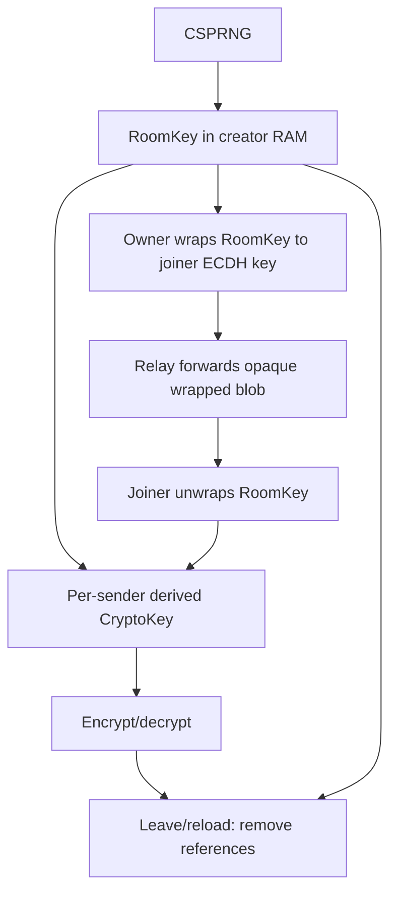

# Security Design

## Cryptographic Primitives

| Purpose | Primitive | Parameters |
|---|---|---|
| Root room secret | CSPRNG | 256 bits via `crypto.getRandomValues` |
| Sender subkey | HKDF-SHA-256 | 256-bit output; salt=roomId; domain-separated info + senderId |
| Message AEAD | AES-256-GCM | 96-bit IV, 128-bit tag, authenticated metadata AAD |
| File subkey + chunk AEAD | HKDF-SHA-256 + AES-256-GCM | salt=roomId, info=`lan-chat-file-v1\n{senderId}\n{fileId}`；每文件独立密钥，每块独立随机 96-bit IV，AAD 绑定 fileId + chunkIndex + chunkCount（防截断、乱序与拼接） |
| RoomKey hand-off | ECDH P-256 + HKDF-SHA-256 + AES-256-GCM | owner wraps RoomKey to the joiner's one-time public key, bound to roomId + requestId |
| Identifiers | browser CSPRNG | UUIDv4 for ephemeral/message IDs; room number is one of eight fixed slots (0001–0008) |

只使用浏览器 Web Crypto API；不实现 AES、HKDF 或 ECDH primitive。Go 服务端不参与任何密码学运算，也不持有任何密钥：它只转发密文与 ECDH 封装结果。

## Key Lifecycle

RoomKey 明文永不发送 Relay；只有房主用 ECDH 派生的临时密钥封装后的密文由 Relay 转发，Relay 无法解出。派生 sender key 应为 non-extractable。浏览器受 GC 管理，无法证明字符串、ArrayBuffer、CryptoKey 已物理覆写；实现只做引用清除与最小化副本。被批准加入者一旦解出 RoomKey，其本地副本即不可撤回。

## Admission Authorization

房间没有密码，也没有口令派生；授权完全由当前房主逐人批准。RoomKey 由房主在浏览器内生成，只在同意某次申请时用该连接的一次性 ECDH 公钥封装后经 Relay 转交。服务器从不接触 RoomKey，也不保存任何认证材料。

安全结论需准确：

- 任何未被房主批准的连接都拿不到 RoomKey，因此无法解密任何消息。
- 没有口令意味着没有第二道门槛：房主误批，或房主本人不可信，都会直接导致泄露。
- 被动读 Relay RAM 的攻击者只能看到密文、封装结果和在线元数据，无法解出 RoomKey。
- 图片与文本走同一条加密路径：浏览器先把图片压缩到约 500KB 以内，再作为明文一起 AES-GCM 加密。
- 文件也走同一条 E2E 路径：每文件从 RoomKey 独立派生 HKDF 子密钥，按 ≤1 MiB 分块独立 AES-GCM 加密后经 HTTP 流式通道传输；Relay 只缓冲密文字节，无法解密，也看不到文件名等元数据（它们在加密通告内）。

## Nonce Policy

每个页面/连接生成 8-byte random prefix，消息计数器从 0 单调递增，以 `prefix || uint32be(counter)` 形成 12-byte IV。sender key 又由唯一 ephemeralId 派生，因此不同发送者拥有不同 AES key 命名空间。计数器达到 `2^32-1` 时 fail closed；绝不 wrap。测试注入 deterministic RNG/counter 验证无重复。

随机 prefix 主要保护异常的同一 ephemeralId/key 重建；依赖浏览器 CSPRNG。恶意客户端仍可故意复用 nonce 并危害它所知的共享 RoomKey；MVP 无法约束被修改的成员客户端。

## Envelope Authentication and Replay

`v/type/roomId/senderEphemeralId/messageId` 以明确 UTF-8 length-prefix 编码作为 AAD。任何字段变化导致 GCM 验证失败。接收端保留当前页面最多 4,096 个 `${senderId}:${messageId}`，FIFO 淘汰；这是内存内重放缓解，不是永久 replay 数据库。服务端不保存 messageId。

timestamp 被刻意省略：它需要时钟/窗口策略，会增加元数据，但不能单独阻止重放。随机 messageId + runtime dedupe 足以满足无历史 MVP。

## Key Distribution and Admission Approval

没有邀请链接，也不存在携带 RoomKey 的 URL；房间号固定为 `0001`–`0008`，没有密码。加入者提交一次性 ECDH 公钥（P-256）后进入待审批，由房主决定是否放行。房主同意时用该公钥派生封装密钥，把 RoomKey 以 AES-256-GCM 封装，AAD 绑定 `roomId + requestId`，经 Relay 转发给加入者；加入者用本地私钥解出。Relay 全程只见公钥与封装密文。

残余风险包括：被污染的前端脚本可窃取内存中的 RoomKey；房主若误批恶意申请，攻击者即可加入；房主离开后待审批申请作废，剩余成员随机产生新房主。

## Transport Security

- 应用层 E2EE 不替代 TLS：TLS 隐藏 roomId、presence、密文 frame 内容与 WebSocket protocol，降低 LAN 注入和流量读取。
- WebSocket handshake 严格验证 Origin；生产明确配置 `ALLOWED_ORIGINS=https://chat.example.local`。
- Nginx TLS 1.2/1.3；HSTS 仅在组织确认域名和证书稳定后启用，默认不对 IP/self-signed 强制长周期 HSTS。
- WebSocket compression 关闭，减少复杂度和压缩侧信道；代理 buffer 关闭。

## Content and UI Security

- CSP：`default-src 'self'; script-src 'self'; style-src 'self'; connect-src 'self'; img-src 'self' data:; object-src 'none'; base-uri 'none'; frame-ancestors 'none'; form-action 'self'`，只允许同源 WSS，不开放任意 `wss:` destination。
- Vite production 无 inline script；没有第三方 CDN/font/analytics。
- React 默认 escaping；消息/nickname 永远不通过 HTML parser。
- 入房只接受固定的 8 个房间号、定长公钥和受长度约束的封装字段；拒绝任何带未知字段的 frame。

## Resource and Protocol Hardening

- 全局 2,000 connections、1,000 rooms，房间 50 members。
- 2 MiB frame、1 MiB plaintext 设计上限（容纳压缩图片）；严格 decoder/字段长度。文件传输是刻意的例外：文件字节不走 WebSocket，而是走独立 HTTP 流式通道（`/api/file/*`），总量无上限，每块明文 ≤1 MiB、独立 AES-GCM。Relay 以 5 分钟生命周期而非字节数约束内存占用，到期逐块清零；下载凭单次性 Bearer token（Relay 只存 SHA-256 摘要，≤60 秒）。
- 每连接 token bucket；待审批申请和限流状态都 connection scoped。
- 握手 15 秒、房主审批等待 60 秒 deadline；ping 30 秒、pong/read liveness；bounded outbound queue 32 frames。
- 未认证连接不能创建多个房间或发送 ciphertext；一个 socket 只允许一次 create/join lifecycle。
- 服务不信任客户端 envelope sender/room 字段，必须与当前 member state 相等。

## Logging Policy

生产禁止 payload、ciphertext、RoomKey、roomId、messageId、nickname、IP、Origin/header、UA 和完整 error object 写入日志。公共吐槽板的名字和内容只进入其明确的 JSON 数据文件，不进入日志；仅固定 process lifecycle/fatal code；Nginx 和 Docker 日志关闭。异常 handler 不调用 `%+v` dump request/socket。

Debug 默认 false。Debug 只允许固定状态计数，不允许用户标识/数据；production build 的静态审计搜索 console 和 logger 调用。

## Public Forum Data Boundary

公共吐槽板不是 E2EE 聊天：发布时服务端会看到虚拟名字和留言内容，并将它们写入 `/data/forum.json`。为满足数据最小化，线程只含 `name`、`message`、`replies`，回复只含 `name`、`message`；API 不接受其他字段，也不生成帖子 ID、时间、IP、MAC、User-Agent 或连接标识。每条主留言可通过数组位置添加回复，数组位置不写入持久文件。

Store 使用 0600 文件权限、固定容量、严格 JSON 解码和原子替换；容器只有 `/data` volume 可写。文件系统仍可能自行维护 mtime/ctime 等宿主属性，应用不读取、展示或把它们作为发表时间字段。

## Host Memory-to-Disk Caveats

Zero Persistence 是应用架构属性，不是物理取证保证：

- swap 可把 Go/浏览器相关 RAM 页写盘；高保障主机可禁 swap，或使用加密 swap 的随机启动密钥。
- hibernation 会把内存快照写入持久存储；专用服务器应禁用 hibernate。
- core dump 是进程内存映像；建议容器 `ulimits.core=0`，宿主按变更流程评估 `Storage=none`、`ProcessSizeMax=0`。
- kdump/crash dump、hypervisor snapshot、EDR 内存采集也可留数据，需组织政策覆盖。
- journald/Docker 默认可能持久 stdout/stderr；Compose 使用 `logging: driver: none`，应用仍避免敏感 stdout。

这些建议会降低诊断能力，不能盲目改整台共享主机；README 提供检查项，由运维根据风险和可用性批准。

## Threat Model and Limitations

完整矩阵见 PRD。重点：

1. Honest-but-curious / passively compromised Relay 看不到消息 plaintext，因为没有 RoomKey。
2. 能修改前端资产的 Relay 管理员可在新页面加载时注入窃密代码；这是浏览器托管 E2EE 的关键限制。
3. 共享固定 RoomKey 不具 Forward Secrecy、post-compromise security 或强 sender authentication。
4. 后加入者不从应用获得历史，但“不能密码学解密任何旧副本”并未实现。
5. endpoint compromise、接收者保存和网络层 metadata 不受本应用绝对控制。

## Disclosure and Dependency Policy

发现漏洞时不要附带真实 payload/key/room code 日志。依赖保持最少并定期执行 `npm audit`、`govulncheck`（若环境安装）；依赖扫描结果不是密码学审计替代品。部署固定 image digest/版本，并审核升级 diff。

## Upgrade Path

- V2 可选口令：引入审计过的 Argon2id/OPAQUE 或 SPAKE2，作为房主审批之外的第二道门槛；必须采用成熟审计库和互操作向量。
- V2 X25519：建立 ephemeral pairwise secrets；需身份确认以抵抗 active Relay MITM。
- V3 ratchet/rekey：旧 key 删除后改善 Forward Secrecy，并在成员变更时轮换。
- V4 Group Sender Keys：高效多人发送和更清晰发送者 key 域；仍需定义成员管理与 transcript consistency。

## Primary References

- [W3C Web Cryptography API](https://www.w3.org/TR/webcrypto/)
- [NIST SP 800-38D: GCM](https://csrc.nist.gov/pubs/sp/800/38/d/final)
- [RFC 5869: HKDF](https://datatracker.ietf.org/doc/html/rfc5869)
- [RFC 9106: Argon2](https://datatracker.ietf.org/doc/html/rfc9106)
- [OWASP Password Storage Cheat Sheet](https://cheatsheetseries.owasp.org/cheatsheets/Password_Storage_Cheat_Sheet.html)
- [OWASP WebSocket Security Cheat Sheet](https://cheatsheetseries.owasp.org/cheatsheets/WebSocket_Security_Cheat_Sheet.html)
